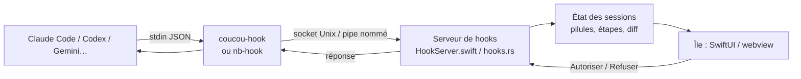
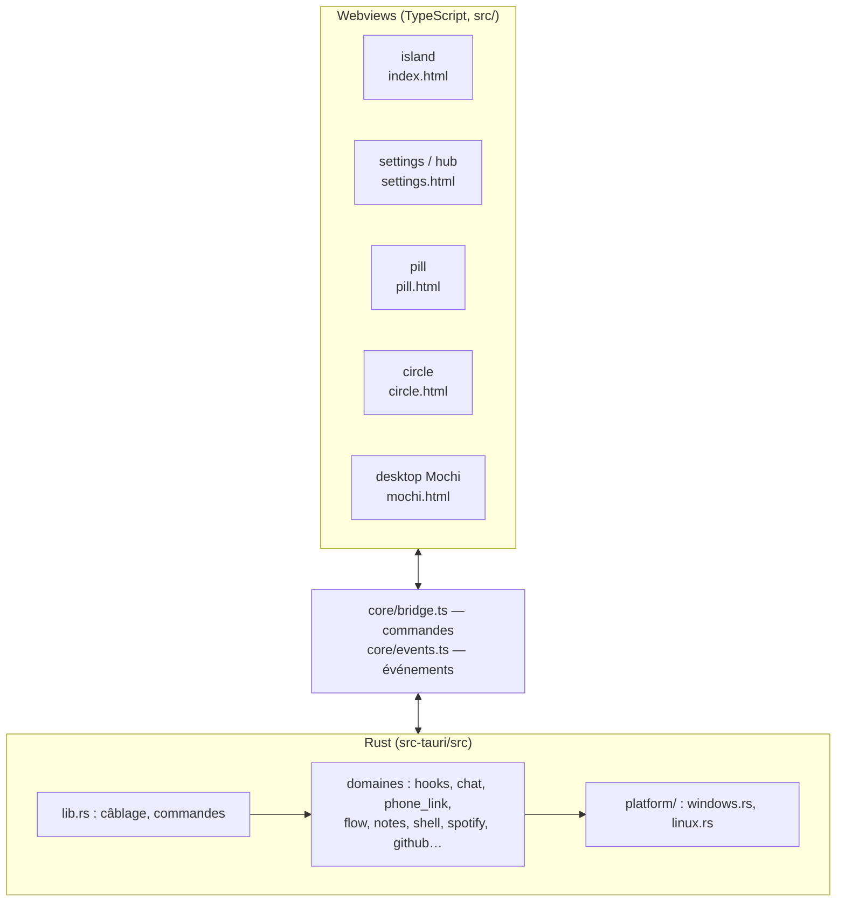
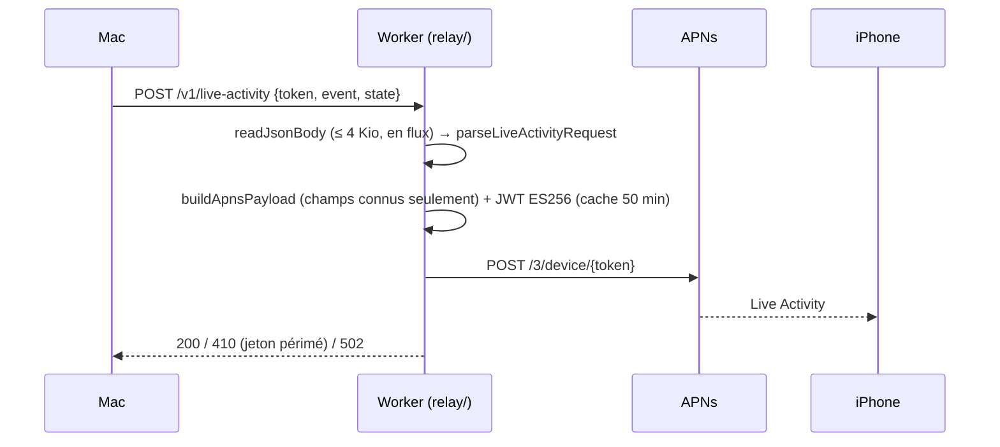

# Architecture

Vue d'ensemble technique de Coucou : les cinq bases de code, comment elles se parlent, et les règles qui les tiennent ensemble. Le comportement (vues, états, intégrations) est décrit dans [SPEC.md](SPEC.md) et [INTEGRATIONS.md](INTEGRATIONS.md) ; l'état de santé du code et la feuille de route dans [AUDIT.md](AUDIT.md).

## Les bases de code

| Dossier | Cible | Langage | Rôle |
| --- | --- | --- | --- |
| `NotchBuddy/Sources/App` | macOS | Swift 6 (SwiftUI + AppKit) | L'app de référence : l'île dans l'encoche, le serveur de hooks, les intégrations, la voix. |
| `NotchBuddy/Sources/CoucouKit` | macOS + iOS | Swift 6 | Code partagé avec l'iPhone : Mochi (`BotEngine`), tenues, catalogue des pilules, diff. |
| `NotchBuddy/Sources/Phone` | iOS | Swift 6 | L'app iPhone, ses widgets et la Live Activity. |
| `windows/` | Windows + Linux | Rust (Tauri 2) + TypeScript | Le portage de l'app Mac (voir `windows/README.md` pour les écarts). |
| `android/` | Android | Kotlin | L'app compagnon, reliée à l'ordinateur par le lien téléphone. |
| `relay/` | Cloudflare Workers | TypeScript | Relais **sans état** des pushes Live Activity (il détient la clé APNs). |
| `android/relay/` | Cloudflare Workers | TypeScript | Relais WebSocket **sans clé** du lien Android hors du Wi-Fi de la maison. |

## Flux principal : d'un agent à l'île

Règle absolue : **le hook ne bloque jamais l'agent.** Si Coucou ne répond pas, le relais sort immédiatement avec la réponse « sans avis » ; seul `PermissionRequest` attend une réponse, sous échéance (`windows/hook/src/main.rs`).

Transports du hook : socket Unix dans le dossier de support (macOS), pipe nommé `\\.\pipe\coucou-<sid>` (Windows), `$XDG_RUNTIME_DIR/coucou.sock` (Linux). Le serveur vérifie l'identité du pair (SID / credentials).

## Windows et Linux (`windows/`)

### Couches

- **Rust** possède tout ce qui touche le système : fichiers, secrets (trousseau via `keyring`), réseau, processus, raccourcis globaux, micro. Un module par domaine ; ce qui dépend de l'OS est isolé dans `platform/` et derrière `#[cfg(...)]`.
- **TypeScript** possède l'affichage. Chaque fenêtre Tauri est une page Vite avec son point d'entrée (`src/main.ts`, `src/settings/main.ts`, `src/pill/main.ts`…). Les petites fenêtres (`pill`, `circle`) n'importent que des modules sans dépendances, pour garder leur bundle minimal.

### Le contrat IPC

| Sens | Où | Typage |
| --- | --- | --- |
| Webview → Rust (commandes) | `src/core/bridge.ts` (`Bridge.*`) | `call<T>` / `callOrThrow<T>` ; une commande Rust qui renvoie `()` est typée `call<null>`. |
| Rust → webview (événements) | `src/core/events.ts` (`EventMap`) | `onEvent(nom, handler)` déduit le type du payload du nom ; un nom inconnu ne compile pas. |

Quand vous ajoutez un `app.emit("x", payload)` côté Rust, ajoutez `"x": Payload` à `EventMap`. Quand vous ajoutez une `#[tauri::command]`, ajoutez son entrée dans `Bridge`.

### Modules utilitaires partagés (TypeScript)

| Module | Pour |
| --- | --- |
| `core/arrays.ts` | `itemAt`, `lastOf`, `cyclicAt` : accès indexé vérifié (le projet compile avec `noUncheckedIndexedAccess`). |
| `core/decode.ts` | `text`, `errorText` : lire des données non fiables (payloads d'intégrations, rejets) sans jamais afficher `[object Object]`. |
| `core/elements.ts` | `requireElement`, `requireChild`, `context2d` : lookups DOM qui échouent en nommant ce qui manque, au lieu de `!`. |
| `views/dom.ts` | `h()` : construction DOM typée par nom de balise, textes liés à la langue (`Msg`). |
| `design/tokens.css` | Toutes les couleurs et polices ; aucune valeur en dur ailleurs (`tests/design-tokens.test.mjs`). |

### Performance

La boucle de rendu de l'île (`island/island.ts`, `frame`) ne tourne que tant que quelque chose bouge et s'arrête d'elle-même ; côté Rust, le sondage du curseur est suspendu quand l'île est repliée (`PollGate`). Mesure dans Chromium headless (Chrome DevTools Protocol, `Performance.getMetrics`) : **0 image/s et 0,02 % du thread principal** une fois l'île au repos.

## Le relais Live Activity (`relay/`)

Le relais ne stocke ni ne journalise rien, et construit lui-même le push : il ne peut pas servir à envoyer une notification arbitraire. Détails dans `relay/README.md`.

## Qualité : ce que chaque pile vérifie

| Pile | Commande locale | CI |
| --- | --- | --- |
| Rust (`windows/`) | `cargo clippy --workspace --all-targets -- -D warnings` puis `cargo test --workspace` | `windows-ci.yml`, `linux.yml`, `phone-link.yml` |
| TypeScript (`windows/`) | `npx tsc --noEmit && npm run lint && npm test` | `windows-ci.yml` |
| Relais (`relay/`) | `npm run typecheck && npm test` | `relay.yml` |
| Relais Android | `npm run typecheck && npm test` | `phone-link.yml` |
| Android | `./gradlew test assembleDebug lint` | `android.yml` |
| macOS / iOS | `xcodebuild` + `scripts/test-*.sh` | `build.yml` |

Politique de lints Rust : `[workspace.lints]` dans `windows/Cargo.toml` (`clippy::pedantic` + `unwrap_used`, avec chaque exception justifiée en commentaire) et `windows/clippy.toml`. Politique TypeScript : `windows/tsconfig.json` (`strict`, `noUncheckedIndexedAccess`, `exactOptionalPropertyTypes`) et `windows/eslint.config.js` (`strictTypeChecked`, chaque écart commenté).
